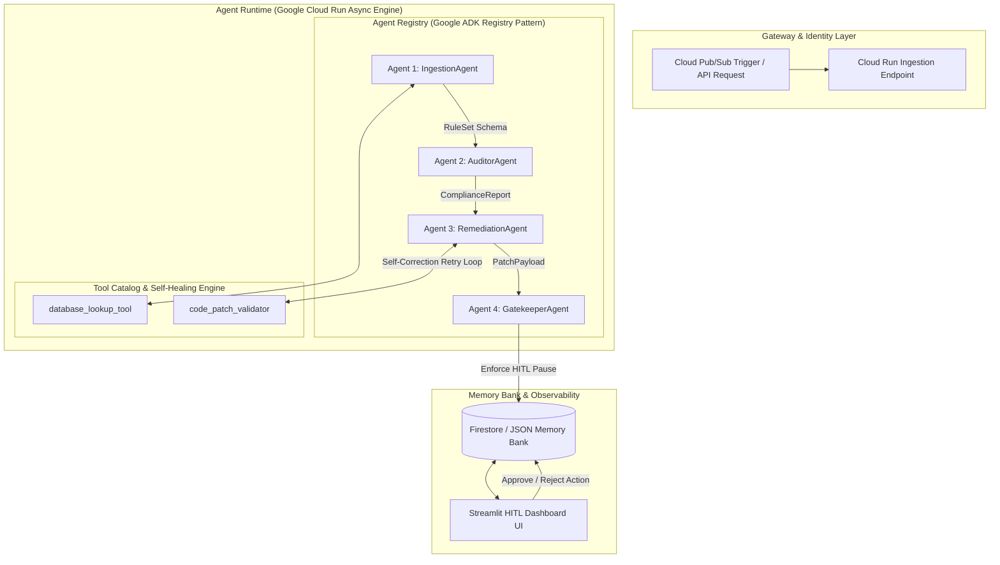

# 🛡️ GuardianFleet: Autonomous Enterprise Compliance & Self-Healing Agent Engine

> **Hackathon Track:** Fortified Enterprise Fleet  
> **Core Stack:** Google Agent Development Kit (ADK), Gemini 2.5/3.5 Flash, Google Cloud Run, Streamlit, Pydantic

GuardianFleet is an autonomous, event-driven multi-agent platform designed to continuously audit enterprise assets—including database schemas, policy documents, and webform disclaimers—against evolving regulatory statutes (e.g., California Labor Code, CCPA/CPRA).

Instead of relying on basic linear scripts or interactive chat loops, GuardianFleet deploys an orchestrated fleet of specialized Google ADK agents that autonomously parse regulations, identify compliance violations, generate exact code/policy patches, **self-heal from tool validation errors**, and pause at a deterministic **Gatekeeper layer for Human-in-the-Loop (HITL) authorization**.

---

## 🏛️ System Architecture & Toolkit Mapping

GuardianFleet maps 1-to-1 onto the mandatory design patterns for the **Fortified Enterprise Fleet** track:



🧩 Toolkit Component Breakdown

| Required Component | Project Implementation | Technology Stack |
|--------------------|------------------------|------------------|
| Agent Registry     | Central catalog of typed, modular sub-agents (IngestionAgent, AuditorAgent, RemediationAgent, GatekeeperAgent) inheriting from a shared BaseAgent parent class. | Python Object Catalog + Google ADK |
| Agent Runtime      | Fully managed, containerized execution environment managing asynchronous agent loops and tool invocations. | Google Cloud Run / Async Python |
| Memory Bank        | Long-term cross-session state store capturing complete execution trajectories, step latencies, tool parameters, and self-healing retry counters. | Firestore / Structured JSON State Memory |
| Guardrails & Safety| Deterministic schema validation via Pydantic models + execution state pause at PENDING_HUMAN_APPROVAL before write operations. | Pydantic Schemas + Gatekeeper Agent |
| Observability      | Real-time visual control panel displaying agent trajectory steps, self-healing metric logs, raw telemetry JSON, and interactive HITL action controls. | Streamlit Dashboard + Structured Logging |

🔁 The Self-Healing Agent Loop
One of GuardianFleet’s core innovations is its autonomous error recovery during policy remediation:

- **Failure Trigger:** When RemediationAgent drafts a fix, it invokes `code_patch_validator`. On initial execution, the validator returns a syntax/schema error trace (e.g., `ERROR 422: Missing required statutory compliance header tag`).
- **Autonomous Analysis:** Rather than crashing or halting execution, RemediationAgent captures the validation error output trace directly from the tool call.
- **Self-Correction:** The agent analyzes the error stack, re-prompts itself to adjust the patch format and statutory headers, and re-invokes `code_patch_validator` until a `SUCCESS` state is achieved.
- **Telemetry Metric:** The total number of retries is logged in the Memory Bank and explicitly surfaced on the Streamlit dashboard as **Self-Healing Retries**.

📁 Repository Structure
```
guardian-fleet/
├── base_agent.py          # Abstract base class for Gemini model setup & tool binding
├── ingestion_agent.py     # Agent 1: Regulatory law & policy parser
├── auditor_agent.py       # Agent 2: Non-compliance auditor
├── remediation_agent.py   # Agent 3: Patch generator with autonomous self-healing loop
├── gatekeeper_agent.py    # Agent 4: Risk evaluator & Human-in-the-Loop pause controller
├── orchestrator.py        # Master SequentialAgent orchestrator & execution state runner
├── tools.py               # Custom Tool Catalog (Enterprise DB lookup & validator tool)
├── schemas.py             # Pydantic data schemas (RuleSet, ComplianceReport, PatchPayload)
├── main.py                # CLI execution entrypoint & async task runner
├── app.py                 # Streamlit Enterprise Compliance & HITL Dashboard
├── requirements.txt       # Core project dependencies
├── README.md              # Project documentation & architecture map
└── .env                   # Environment variables (Gemini API Key)
```

🚀 Quickstart Guide
1. **Prerequisites**
   - Python 3.10 or higher installed
   - Google AI Studio API Key (Get a free key [here](https://console.cloud.google.com/apis/credentials))

2. **Environment Setup**
   ```bash
   git clone https://github.com/YOUR_USERNAME/guardian-fleet.git
   cd guardian-fleet

   # Create virtual environment
   python3 -m venv venv
   source venv/bin/activate  # On Windows: .\venv\Scripts\Activate.ps1

   # Install dependencies
   pip install -r requirements.txt
   ```

3. **Configure API Key**
   Create a `.env` file in the root directory:
   ```plaintext
   GEMINI_API_KEY="AIzaSyYourActualGeminiApiKeyHere"
   ```

4. **Run the Backend Multi-Agent Pipeline**
   ```bash
   python main.py --policy-id policy_ca_labour_2026
   ```

5. **Launch the Streamlit Dashboard**
   ```bash
   streamlit run app.py
   ```

Navigate to [http://localhost:8501](http://localhost:8501) in your web browser to view real-time agent metrics, inspect the self-healing trajectory, and test the Approve & Execute Patch control button.

📦 Cloud Run Deployment
To deploy GuardianFleet to Google Cloud Run as a containerized service:
```bash
# Authenticate with Google Cloud
gcloud auth login
gcloud config set project YOUR_PROJECT_ID

# Deploy directly from source
gcloud run deploy guardian-fleet \
  --source . \
  --region us-central1 \
  --allow-unauthenticated \
  --set-env-vars GEMINI_API_KEY="YOUR_GEMINI_API_KEY"
```

📄 License
Distributed under the MIT License. Built for the Google Cloud & Gemini Hackathon (2026).